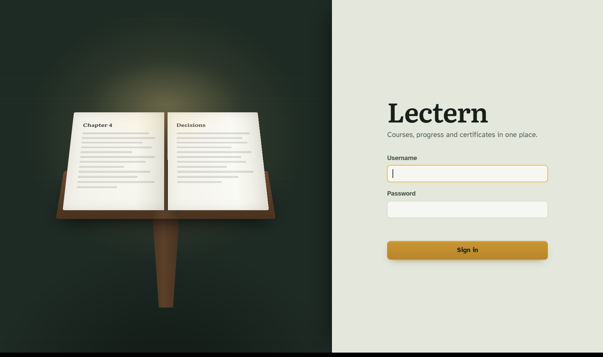
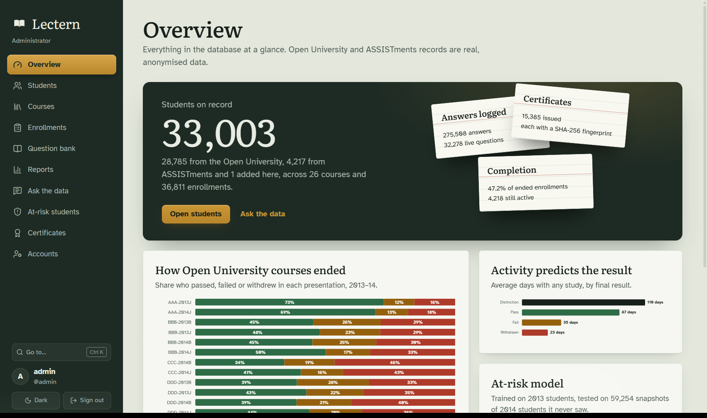
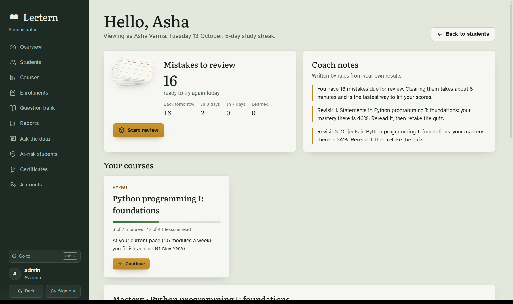
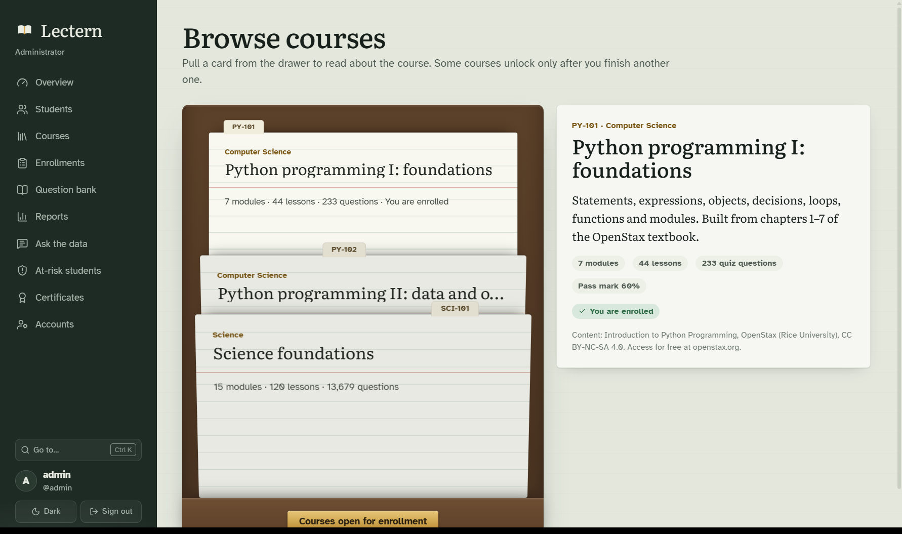
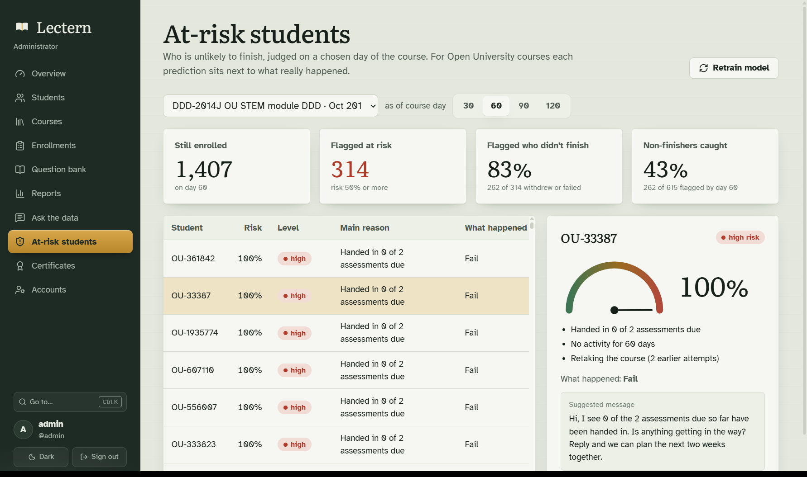
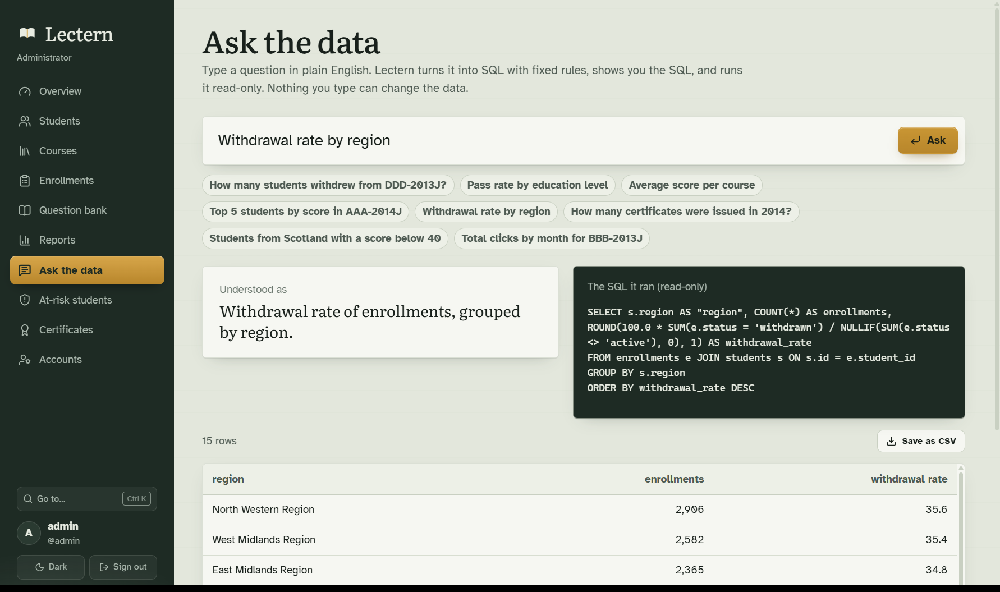

# Lectern

A desktop e-learning platform built on a real SQL database. It manages courses, students, enrollments, progress, quizzes and certificates, and adds tools that help teachers teach and students remember.

A Python desktop app: the window is pywebview, the interface is React with Motion for its 3D and sliding pieces, and everything behind it is Python, SQLite and scikit-learn. Everything runs offline: no paid API and no internet connection. All data is real and published (see [the database and its data](docs/database.md)).

## What it does

**Core**
- Add, edit and remove students, courses, modules and lessons
- Enroll and drop students; prerequisites are checked by the app *and* by a database trigger
- Track progress: lessons read, module scores, quiz attempts, daily study activity
- Certificates issued automatically when a course is complete, as PDFs with a QR code
- Reports on performance, completion and drop-out, exportable as CSV
- Three roles: admin, instructor, student. Everyone can change their password; the admin can reset a forgotten one or remove an account
- Students can enroll themselves from the catalog and leave a course

**What it looks like**
- A classroom-and-reading-room look: chalkboard slate, brass, index cards. Light and dark appearance.
- The sign-in screen is a book on a lectern that turns its pages as the app opens.
- Courses sit as index cards in a card-catalog drawer that lift out when picked.
- Mastery is an isometric skyline of blocks; quiz questions slide past like a deck of cards; certificates and question previews flip over to show the answer or the fingerprint.
- Ctrl+K opens a palette to jump to any screen.

**What makes it different**
- **Mistake review queue**: wrong answers come back after 1, 3, then 7 days (the Leitner system)
- **Question health check**: finds quiz questions that are too easy, too hard, or that strong students get wrong, using difficulty and discrimination indexes from exam-board item analysis
- **Mastery map**: each module shaded by how well the student knows it, with recent answers counting more
- **Study calendar and streaks**: a year of study days at a glance
- **Tamper-evident certificates**: a SHA-256 fingerprint of the certificate's details; edit the PDF and it fails verification
- **Pace forecast**: "at your current pace you finish around 1 Nov"
- **Grade audit trail**: every score change recorded by a database trigger, with who was signed in

**Smart features (rules and machine learning, no language model)**
- **Ask the data**: plain-English questions turned into SQL by a rule-based parser. It shows the SQL, runs read-only, and can't change data.
- **At-risk prediction**: logistic regression trained on 2013 Open University students and tested on 2014 students it never saw (ROC AUC 0.79). Each prediction comes with its reasons and a suggested message.
- **Question drafter**: makes multiple-choice drafts from lesson text. TF-IDF picks the key terms; distractors are terms used in similar contexts, found with LSA.
- **Progress coach**: a rule engine that writes study notes and a 7-day plan from the student's own results.
- **Recommender**: content similarity plus "students who took X also took Y", with a reason for each suggestion.

## Screens

| | |
|---|---|
|  |  |
|  |  |
|  |  |

More in [docs/screenshots](docs/screenshots).

## Data

| Source | Used for |
|---|---|
| Open University Learning Analytics Dataset (32,593 enrollments, 10.6M activity rows) | Students, enrollments, scores, activity, outcomes, the at-risk model |
| ASSISTments 2009–10 (275,458 answers) | Question health check, mastery |
| OpenStax *Introduction to Python Programming* | Two Python courses: lessons, videos, 390 questions with the official answer key |
| SciQ (13,679 questions) | Five short science courses, built from topics found by k-means clustering |

Dataset students are anonymised, so they appear as IDs (`Student 11391`). Their courses ran in 2009–2014 and are closed to new enrollments; new students and courses are added in the app.

## Run it

Needs Python 3.11 or newer.

```powershell
cd "D:\study\claude projects\elearning-platform"
python -m venv .venv
.\.venv\Scripts\Activate.ps1
python -m pip install -r requirements.txt
Copy-Item .env.example .env
```

Download the four datasets into `data/raw/` ([instructions](docs/database.md#part-2-data-sources)), then build the database (about 80 seconds) and start the app. The interface is already built in `webui/dist`, so Node isn't needed just to run it:

```powershell
python -m db setup
python -m app
```

On first start Lectern asks you to create the admin account.

To test the same interface in a web browser instead of the window: `python -m app --browser`.

To change the interface, install Node.js, then:

```powershell
cd webui
npm install
npm run build
```

Run the tests:

```powershell
python -m pytest
```

## How it is built

```
Interface (webui/)    React screens in a pywebview desktop window
  ↓  one call: api(method, data)
Bridge (app/api.py)   checks who is asking, calls the right service, returns JSON
  ↓
Services (services/)  the rules: enrollments, quizzes, certificates, reports…
Smart (smart/)        rule engines and scikit-learn models
  ↓
DB layer (db/)        one place that opens connections; every value is a parameter
  ↓
SQLite (data/lectern.db)
```

The interface never writes SQL and the database never knows about buttons. The schema (`db/schema.sql`) has 23 tables in third normal form, foreign keys with cascade rules, CHECK and UNIQUE constraints, 13 indexes, three views and three triggers. See [the database](docs/database.md) and [how it works](docs/how-it-works.md).

```
app/        start-up and a test web server (__main__.py), settings, the bridge (api.py)
db/         schema, connection, importers for each dataset
services/   students, courses, enrollments, quizzes, review queue, progress, certificates, reports, auth
smart/      ask the data, at-risk model, drafter, coach, recommender, text tools
webui/      the interface: React screens, design tokens (src/styles/tokens.css), charts, 3D pieces
tests/      109 tests: 103 on a small hand-built database, 6 on the real one
docs/       how it works, the database and its data, review questions, learning tasks, PPT brief
```

## Limitations

- A desktop app for one machine. A shared web version would move the same SQL to PostgreSQL behind a server.
- Video lessons are links to the textbook's videos, not hosted streaming.
- Drafted questions need a human check, which is why every draft goes through review.
- "Ask the data" understands a defined set of question shapes, not any English sentence.
- The at-risk model's precision is about 0.66 and recall 0.62 on unseen students: useful for deciding who to check on, not for judging anyone.
- ASSISTments problems have no text in the public data, so they can't be shown as quizzes.

## Credits

Data: OULAD (Kuzilek et al., 2017, CC BY 4.0); ASSISTments 2009–2010 (WPI); *Introduction to Python Programming*, OpenStax, CC BY-NC-SA 4.0, access for free at openstax.org; SciQ (Welbl et al., 2017, Allen Institute for AI, CC BY-NC 3.0).
