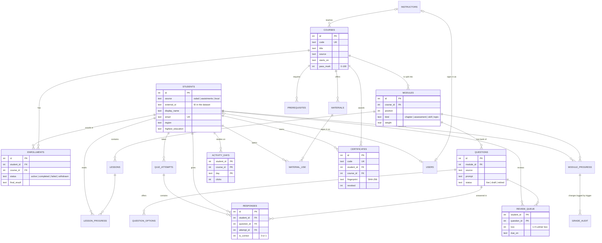

# The database and its data

Part 1 is the table design. Part 2 is where the data comes from and how to download it.

## Part 1: tables and how they link

The main tables and how they link. Crow's-foot notation: `||--o{` reads "one … to zero or many".
Bookkeeping tables (`app_session`, `model_runs`, `meta`) are left out.



### Why it is shaped like this

- **Enrollments** sit between students and courses because the relationship is many-to-many (a student takes many courses; a course has many students). `UNIQUE (student_id, course_id)` stops double enrollment.
- **Module progress** and **review queue** use two-column primary keys: one row per student per module, one row per student per question.
- **Activity days** stores one row per student, course and day rather than 10.6 million raw clicks: the importer adds them up, so reports stay fast.
- **Question options** are a separate table, not columns `option_a … option_d`, so a question can have two to five options without empty columns.
- **Grade audit** is written only by a trigger, so no part of the app can change a score without leaving a record.


## Part 2: data sources

Lectern uses only real, published data. Nothing is generated. Each source covers a different part of the app, and they are kept separate on purpose: we never pretend that Open University students studied the OpenStax textbook, for example.

| Source | What it gives us | Size | Licence |
|---|---|---|---|
| OULAD | Students, enrollments, assessment scores, daily activity, final results | 32,593 enrollments, 10.6M activity rows | CC BY 4.0 |
| ASSISTments 2009–10 | Per-question right/wrong answers | 4,217 students, 275,458 answers | Free for research and education, with citation |
| OpenStax *Introduction to Python Programming* | Lessons, video links, quiz questions with the official answer key | 85 lessons, 390 questions | CC BY-NC-SA 4.0 |
| SciQ | Science multiple-choice questions with supporting paragraphs | 13,679 questions | CC BY-NC 3.0 |

### Download

Put the files in `data/raw/` exactly like this (the folder is ignored by git):

```
data/raw/
  oulad/         studentInfo.csv, studentVle.csv, ... (unzipped)
  assistments/   skill_builder_data.csv
  sciq/          SciQ dataset-2 3/train.json, valid.json, test.json
  openstax/      intro-python.pdf
```

1. **OULAD** – https://archive.ics.uci.edu/dataset/349/open+university+learning+analytics+dataset (zip, 45 MB; unzip into `data/raw/oulad/`).
2. **ASSISTments 2009–2010 skill builder** – https://doi.org/10.6084/m9.figshare.25309000, file `skill_builder_data.csv` (83 MB).
3. **SciQ** – https://allenai.org/data/sciq (zip, 3 MB; unzip into `data/raw/sciq/`).
4. **OpenStax** – https://openstax.org/details/books/introduction-python-programming, "Download a PDF" (10 MB), saved as `data/raw/openstax/intro-python.pdf`.

Then build the database (about 80 seconds):

```
python -m db setup
```

### How each source is used

**OULAD (Open University Learning Analytics Dataset).** Each of the 22 module presentations (for example `DDD-2013J`) becomes a course. Its assessments (TMAs, CMAs and the final exam) become the course's modules, and assessment scores become module scores. Final results map to enrollment status: Pass and Distinction → completed (and a certificate is issued on the last day of the course), Fail → failed, Withdrawn → withdrawn. The 10.6 million click rows are added up per student per day (study calendar, streaks, at-risk model) and per student per learning material (materials linked to passing).

*One assumption:* OULAD gives dates as "days since the presentation started" and only says presentations start in February (B) or October (J). We put day 0 on the 1st of that month. Everything else is as published.

**ASSISTments.** One course, "Maths skill builder 2009–10". Each skill is a module and each problem a question. Only original problems are kept (not the scaffolding sub-steps), and rows repeated for multi-skill problems are counted once. The log has no problem text and no dates, only an order number, so these questions can't be taken in the app. They power the question health check and the mastery map, which need real answers per question.

**OpenStax.** The textbook is split into two courses: *Python programming I* (chapters 1–7) and *Python programming II* (chapters 8–15), with I required for II. Chapters become modules, numbered sections become lessons, the book's own video links are attached to lessons, and the "Concepts in practice" questions become the quiz bank, marked with the book's answer key and explanations. The PDF is read in layout mode so code keeps its indentation.

**SciQ.** Six short science courses (chemistry, physics, earth, cells, the human body, plants and animals). SciQ has no topic labels, so the questions are grouped into 15 topics with TF-IDF, LSA and k-means clustering; each topic is named after its three strongest words. Each topic's readings are the supporting paragraphs closest to the topic's centre.

### Citations

- Kuzilek, J., Hlosta, M. & Zdrahal, Z. (2017). Open University Learning Analytics dataset. *Scientific Data* 4, 170171. https://doi.org/10.1038/sdata.2017.171
- Feng, M., Heffernan, N. & Koedinger, K. (2009). Addressing the assessment challenge with an online system that tutors as it assesses. *User Modeling and User-Adapted Interaction* 19(3), 243–266. Data: ASSISTments 2009–2010 skill builder.
- Das, U., Lawson, A., Mayfield, C. & Norouzi, N. *Introduction to Python Programming*. OpenStax, Rice University. Access for free at openstax.org.
- Welbl, J., Liu, N. F. & Gardner, M. (2017). Crowdsourcing Multiple Choice Science Questions. *Proceedings of the 3rd Workshop on Noisy User-generated Text*. Allen Institute for AI.

Lessons from OpenStax show the line "Access for free at openstax.org" as the licence requires. The SciQ and OpenStax licences are non-commercial; this is a student project and not sold.
