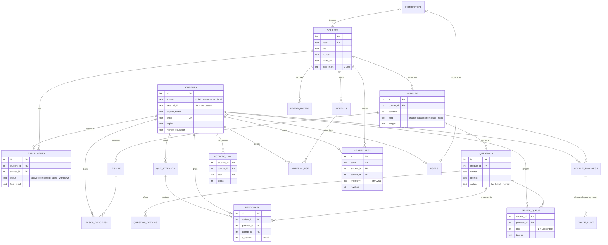

# Entity–relationship diagram

The main tables and how they link. Crow's-foot notation: `||--o{` reads "one … to zero or many".
Bookkeeping tables (`app_session`, `model_runs`, `meta`) are left out.

## Why it is shaped like this

- **Enrollments** sit between students and courses because the relationship is many-to-many (a student takes many courses; a course has many students). `UNIQUE (student_id, course_id)` stops double enrollment.
- **Module progress** and **review queue** use two-column primary keys: one row per student per module, one row per student per question.
- **Activity days** stores one row per student, course and day rather than 10.6 million raw clicks: the importer adds them up, so reports stay fast.
- **Question options** are a separate table, not columns `option_a … option_d`, so a question can have two to five options without empty columns.
- **Grade audit** is written only by a trigger, so no part of the app can change a score without leaving a record.
